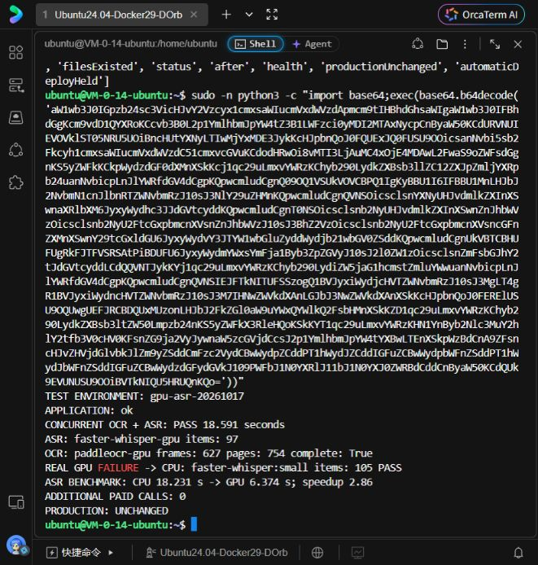

# GPU 语音部署与验证记录

2026-10-17，仅测试环境。未运行整剧测试，未调用收费模型。

## 部署与保护

- 测试版本 `gpu-asr-20261017`，容器 `jubianbian-staging-app-1`，部署后 health 为 `ok`。
- 正式容器 ID、镜像、启动时间与部署前完全一致。
- 保留 Whisper small、beam=5、原短句 VAD、逐词时间戳及原证据缓存；GPU 使用 CUDA float16。PCM 以 gzip 级别1无损压缩传输，并核对解压后的采样数。
- GPU 空结果、不完整响应、超时或故障会回退原 CPU 识别。ASR 启动失败不关闭 OCR。
- 上轮空稿拦截、缺段检查和有界补缺仍保留；GPU 加速不能代替整剧内容验收。
- `.staging-deploy-hold` 继续生效，避免 main 自动发布覆盖本次测试版本。

## 实测与回归

使用已有 156.502 秒视频，不改原任务数据。

| 项目 | 结果 |
| --- | --- |
| CPU 语音 | 18.231 秒 |
| GPU 语音，含提取与传输 | 6.374 秒，约快 2.86 倍 |
| GPU 上传 / 推理 | 2.027 / 3.803 秒 |
| CPU / GPU 首尾时间 | 均为 0.79～155.04 秒 |
| CPU / GPU 逐词数量 | 均为 562 |
| 规范化文本相似度 | 98.92%；float16 与原 CPU int8 转写并非逐字相同 |
| 部署后 OCR 与 ASR 同时运行 | 18.591 秒，均返回 GPU provider |
| 并行 OCR 采样 | 627 帧、754 页，complete=true，232 条证据 |
| 并行 ASR | 97 条证据 |
| 故意使用错误 token 后真实 CPU 回退 | 19.19 秒，105 条证据，provider=faster-whisper:small |
| 新增收费模型调用 | 0 |

Linux 隔离后端完整回归 257 项通过；随后增加无损传输测试，ASR 专项共6项通过。OCR 远端4项、跨帧页面3项及缓存15项检查通过。无损传输测试验证解压 PCM 与原数据逐字节相同、采样数一致。

按当前样本与任务链路估算，上传完成后：90集、约209分钟视频需20～35分钟；100集、231分钟需25～40分钟。模型生成、自动补缺复核、GPU负载和跨机传输均影响总耗时，以上不是整剧实测或时限承诺。此次没有重新验收整剧的内容完整性。

## 证据与回滚

服务端目录 `/opt/jubianbian-gpu-asr-20261017/`：

- `deployment.json`、`deploy.log`：部署版本及正式环境未变的核对记录。
- `benchmark-final.json`、`asr-benchmark-final.log`：最终 CPU / GPU 对照。
- `deployed-verification.json`、`deployed-verification.log`：真实并行识别和鉴权失败后的 CPU 回退。
- `linux-tests-final.log`：隔离完整回归。
- 备份 `deployment-backup-20261017T074803Z`。

应用可清空 `JBB_ASR_REMOTE_URL` 并重建测试容器，恢复仅用原 CPU 的语音路径。

## 换 GPU 复用

最终迁移包 `/root/autodl-tmp/jbb-ocr/gpu-ocr-migration.tar` 已更新，大小7,496,386,560字节、218个成员，校验文件为同目录 `.tar.sha256`。已核对包内包含最终 gzip 传输源码、Whisper small 模型、依赖锁文件与 wheel 缓存，不含 token、私钥、known-hosts 或视频。

包当前仅保存在该实例数据盘，释放实例前需另存持久存储；三份连接文件需另行安全迁移。换卡后仍须检查兼容性及真实端到端识别。操作见 [GPU OCR 配置与换机](gpu-ocr-deployment.md)。

