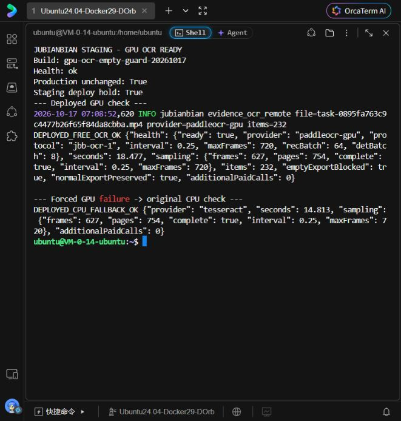

# GPU OCR 与空稿防护验证记录

验证日期：2026-10-17。范围仅为测试环境，未启动收费整剧重跑。

## 部署结果

- 测试版本：`gpu-ocr-empty-guard-20261017`，容器 `jubianbian-staging-app-1`，部署后 health 为 `ok`。
- 正式环境的容器 ID、镜像 ID、启动时间与部署前记录完全一致。
- `.staging-deploy-hold` 已生效，避免自动同步 main 覆盖本次测试修复；合并改动并核对版本后再解除。
- 服务端部署记录：`/opt/jubianbian-gpu-ocr-20261017/deployment.json`。
- 回滚备份：`/opt/jubianbian-gpu-ocr-20261017/deployment-backup-20261017T070626Z`。

## 实测与回归

- Linux 后端测试 252 项通过，运维测试 12 项通过。
- 使用已有的 156.502 秒视频验证，不修改原任务数据，不调用收费视频模型或新增 ASR 请求。
- 部署后的真实 GPU 链路：18.477 秒，627 帧、754 个 OCR 页，`complete=true`，provider 为 `paddleocr-gpu`。
- 故意使用错误 token，在独立验证进程触发 GPU 401 后，自动回退原 CPU OCR：14.813 秒，同样处理 627 帧、754 页，`complete=true`。未修改运行中应用的 token。
- 空正文导出返回 HTTP 409；含有效动作正文的正常剧本仍可导出。
- 空稿在模型解析、任务保存、管理员放行和下载环节拦截；覆盖率计算忽略隐藏或空文本，避免假覆盖。
- 检测或识别结果少页时 GPU 服务报错，由应用回退 CPU；不能把缺页响应当作完整结果。

GPU 当前单条端到端耗时并未优于已优化的 CPU（约15秒）；跨机传输和请求开销仍在。该测试验证了 GPU 可用、采样完整和回退行为，不能据此承诺整剧的总耗时或模型永不漏段。空输出不会被作为成功剧本交付。

服务端证据：

- `deployed-verification.log`：真实 GPU、空稿拦截及正常导出。
- `deployed-fallback.log`：真实 CPU 回退。
- `linux-tests-final.log`：后端回归。
- `ocr-benchmark-final.json`：此前 CPU/GPU 对照。

上述文件位于 `/opt/jubianbian-gpu-ocr-20261017/`。

## 换 GPU 的复用成果

- 脚本：`ops/manage_gpu_ocr.py`，提供 `install/start/status/stop/bundle`。
- 已验证 RTX PRO 6000 Blackwell 96GB、driver 590.44.01、Python 3.10、Paddle GPU 3.4.0 CUDA 12.9、PaddleOCR 3.4.0。
- 模型与 wheel 缓存驻数据盘；新机器重建 venv，按锁文件离线安装。已在全新 venv 实测离线安装、依赖检查和 CUDA 算子成功。
- 单 worker 常驻模型，检测 batch 8、识别 batch 64；重复 start 不会重复启动服务，SSH 连接失败后重连。
- 服务仅监听 GPU loopback，通过受限 SSH 反向隧道接入测试环境。
- 机器重启后仍需运行 start；每台新卡仍需兼容性与端到端检查。

迁移包：`/root/autodl-tmp/jbb-ocr/gpu-ocr-migration.tar`。

- 大小：6,905,384,960 字节，185 个成员。
- SHA-256：`cb0b1266cb5c729646f7defc16c3f0653833782c7decebb635d55c7eb9bd0844`。
- 同目录有 `.tar.sha256` 校验文件。
- 包含最终源码、依赖锁文件、wheel 与模型缓存；不含连接 token、私钥或视频。
- `service.env`、`tunnel-key`、`cloud-known-hosts` 需另行安全迁移，不能提交 Git。

当前迁移包只保存在该 GPU 实例数据盘，尚未复制到跨实例持久存储；账号的 AutoDL 文件存储尚未初始化。释放或删除实例前必须另存迁移包、校验文件及连接文件，否则不能保证下次仍可复用缓存。

详细命令见 [GPU OCR 配置与换机](gpu-ocr-deployment.md)。

